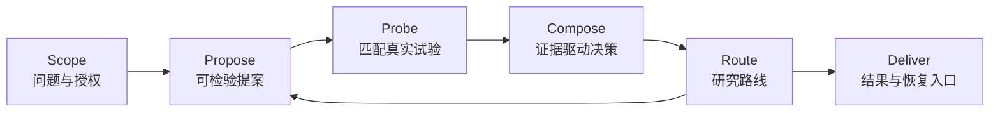

# research

**把研究问题变成可检验的实验、可追溯的证据和可恢复的研究状态。**

<p align="center">
  
</p>

`research` 是一项通用 Agent Skill。它用 Propose–Probe–Compose 组织模型推理与宿主执行器提供的真实执行，帮助 Agent 设计公平对照、锁定研究设计、保留失败证据、选择研究路线，并在预算中断后继续工作。技能同时提供实证识别、设定搜索、数据溯源、复现审计和形式模型验证的可复用检查卡，以及可执行的运行清单、确定性评价与发布审计门槛。

[快速开始](#快速开始) · [核心方法](#核心方法) · [使用示例](#使用示例) · [结构化契约](#结构化契约) · [设计文档](skill_design.md) · [许可证](LICENSE)

## 为什么使用 research

研究生成更多候选、写出更长报告或得到更高单次分数，都不足以回答研究系统是否真正改进。`research` 将执行证据置于研究循环中心：

- **公平比较**：不同覆盖范围的任务先在共同可评估样本上对齐，再计算配对差值。
- **设计锁定**：读取结果前固定问题、主要指标、数据快照、参数、种子、异常规则和证据等级；回顾性锁定显式披露。
- **真实反馈**：提案经过有界 Probe 后才进入采纳决策，失败与空结果保留原状态。
- **确定性采纳**：主要指标改善、硬门槛和守卫指标退化共同决定采纳。
- **连续研究**：活动方案、参照方案、经验记忆和路线历史分别维护。
- **可恢复执行**：协议身份、真实用量和恢复现场一起保存，避免重复模型调用。
- **审计门槛**：审计报告绑定具体提交，未关闭的高严重度问题阻止发布。
- **克制结论**：开发证据、选择证据、确认证据与独立样本外证据分别命名。

## 核心方法



### 区分两个研究层次

**Candidate search** 关注具体候选，例如表达式、程序、模型或配置。它回答“哪个候选表现更好”。

**Research-harness evolution** 关注产生候选的执行系统，例如提案策略、记忆、诊断、搜索算子和预算分配。它回答“哪种研究方式能够持续产生更好的结果”。

每次运行先声明研究层次，再选择对应的实验单位、参照方案和主要指标。

### Propose–Probe–Compose

**Propose**：每项提案携带假设、最小编辑、预期机制、适用范围、否证条件、模型身份与真实用量。自由文本想法经过结构校验后才进入执行。

**Probe**：各条件共享任务、输入、数据角色、种子、预算、评价器和共同支持。选择与诊断使用有界真实执行。

**Compose**：主要指标与行为约束共同决定 `kept`、`revised`、`dropped` 或 `inconclusive`。组合编辑重新评价，避免从单项表现推断组合效果。

### 五类研究路线

- `EXPLOIT`：在当前协议内利用已有机制。
- `REPAIR`：修复已定位缺陷，使用相同口径复核。
- `FORK`：保留当前状态，为不同机制路径建立分支。
- `REFRAME`：重设研究问题，以新协议和新运行承接。
- `STOP`：问题已回答、预算耗尽或继续执行缺乏信息价值时停止。

### 设计锁定与证据等级

读取结果前保存设计锁定卡，记录研究层次、主要结果方向、证据等级、设计参考、数据快照、映射版本、样本与排除规则、参数与随机种子、估计量或求解方法、异常标记规则、否证条件与停止条件。结果产生后补充的锁定卡标记为回顾性设计锁定，并披露主要选择的实际形成时间。

证据等级分为 E1 实证结果、E2 校准结果、E3 情景结果和 E4 理论推测。模拟输出保持 E3；增加样本、延长运行或提高精度不改变等级。

### 可执行运行合同

运行清单固定问题、证据、协议、参数空间、执行命令、评价规则和预算。评价同时检查运行成功、必需指标、硬门槛、主要指标改善和守卫指标退化。状态保存活动方案、基线、连续失败、已采纳补丁、代码基准提交和恢复入口；中断运行保留为 `interrupted`。

代码补丁在独立 Git 工作树中执行，只允许声明的路径前缀，拒绝删除、重命名、符号链接、文件模式变化和越界修改。审计报告绑定提交，发布门槛要求工作区干净、验证通过、报告覆盖所有高严重度问题且提交之后只追加审计文件。

### 领域研究检查卡

[设计与有效性](references/design-validity.md) 提供以下可复用检查卡：

- 设计锁定卡与 E1—E4 证据等级；
- 因果识别卡、网络干扰与四类估计量；
- 设定搜索台账、异常标记、零效应校准和已知真值恢复；
- 数据来源、运行、图表和结论四类台账，时点信息集与清洁目录复现；
- 形式模型身份卡、均衡选择、单边偏离测试和数值验证。

## 快速开始

### 安装到 Claude Code

```bash
git clone https://github.com/Alyosha28/research-skill.git ~/.claude/skills/research
```

其他支持 Agent Skills 的宿主可以直接安装仓库根目录。无需构建，也无需安装运行时依赖。仓库提供技能规则、状态契约与通用检查器，实验执行由宿主研究执行器完成。

### 启动研究

显式调用 `/research`，或直接描述研究任务：

```text
两个实验臂的任务覆盖不同。请设计一个使用共同可评估样本、共享预算和固定主要指标的配对实验。
```

技能会自动加载当前分支需要的规则。`SKILL.md` 保持精简，详细契约位于 `references/`。

## 使用示例

### 公平比较两个条件

```text
我们正在比较增加结构化记忆与固定基线。两个条件的覆盖任务不同，团队还想在看到结果后改选指标。请给出可证伪的小实验。
```

技能会确定共同支持、共享预算、配对实验单位、主要指标、否证条件和失败处理方式。

### 锁定实验设计

```text
我们准备在两个条件下比较结构化记忆。请给出读取结果前需要固定的设计锁定卡，覆盖主要指标、数据快照、参数、随机种子、异常标记、否证条件和证据等级。
```

技能会区分开发数据与确认数据，要求结果产生后补充的锁定卡披露形成时间，并把设计变更交给新协议承接。

### 检查发布审计

```text
发布前有一个高危问题仍未关闭，部分检查命令返回非零。请判断当前提交能否发布，并列出审计报告需要记录的字段和门槛。
```

技能会阻止发布判定，要求报告绑定具体提交，记录命令返回码、问题严重度与状态、残余风险和未覆盖范围。

### 评价研究执行系统

```text
研究代理这周生成了更多候选。这个证据能说明 research harness 已经改进吗？需要哪些对照？
```

技能会区分候选产出与执行系统证据，要求匹配基线、共同样本、预算控制和范围准确的判定。

### 处理部分失败

```text
十二项任务中有三项超时。请定位原因，保留失败状态，并设计能够区分基础设施故障与研究假设未获支持的检查。
```

技能会保留原始运行、比较成功与失败轨迹，并给出最小诊断路径。

### 恢复中断的研究

```text
proposal.json 和 model_usage.json 已保存，执行器随后在候选运行前超时。请恢复执行，保留累计预算并避免重复模型调用。
```

技能会要求宿主执行器复用已保存提案、继承真实用量、保持原协议身份，并从恢复现场继续执行。

## 证据与执行契约

### 可追溯主张

每项定量主张记录对象、指标、数值、单位、分母、比较方向、总体或窗口和统计单位。主张状态使用 `supported`、`contradicted`、`inconclusive` 和 `unverified`。

### 共同支持

跨候选比较先确定共同可评估实验单位，再计算指标与差值。缺失、超时、无效提案和不可评价项不会被静默补零或删除。

### 确定性采纳

采纳要求运行成功、必需指标存在且为有限数值、硬门槛满足、主要指标改善达到最小阈值、守卫指标退化不超过容差。评价结果保存改善前后数值、改善量和全部拒绝原因。

### 审计门槛

审计报告记录被审计提交、检查命令与返回码、问题严重度、问题状态、修复建议和残余风险。存在未关闭的 `critical` 或 `high` 问题时，`pass` 无效；`fail` 与 `needs-human` 阻止发布。报告提交之后的代码改动使报告失效。

### 真实研究记忆

经验条目包含来源、适用范围和实际使用位置。只有进入后续提案并留下使用证据的内容才构成研究记忆。选择阶段结果与敏感字段不会直接进入提案上下文。

### 预算与恢复

调用前检查剩余额度，调用后记录真实用量。恢复时保留协议、输入、评价器、累计成本与失败记录；新协议通过新运行承接。

## 结构化契约

仓库附带四个仅使用 Python 标准库的检查器。

核对主张记录、本地来源、JSON Pointer 与定量值：

```bash
python3 scripts/check_research_record.py assets/research_record.example.json --root assets
```

核对执行中研究状态、提案、预算、路线和恢复身份：

```bash
python3 scripts/check_research_state.py assets/research_state.example.json
```

示例位于 [`assets/research_record.example.json`](assets/research_record.example.json) 与 [`assets/research_state.example.json`](assets/research_state.example.json)。

检查研究运行清单与确定性评价：

```bash
python3 scripts/check_campaign.py assets/campaign.example.json
python3 scripts/check_campaign.py assets/campaign.example.json \
  --result assets/run_result.example.json \
  --baseline assets/baseline_result.example.json
```

检查审计报告：

```bash
python3 scripts/check_audit_report.py assets/audit_report.example.json --commit 4f3c2a1
```

检查器验证结构与评价规则。领域计算由宿主研究执行器完成，来源内容和主张语义仍需实际审阅。

## 验证

运行回归测试与示例检查：

```bash
python3 -m unittest discover -s tests -v
python3 scripts/check_research_record.py assets/research_record.example.json --root assets
python3 scripts/check_research_state.py assets/research_state.example.json
python3 scripts/check_campaign.py assets/campaign.example.json
python3 scripts/check_campaign.py assets/campaign.example.json \
  --result assets/run_result.example.json \
  --baseline assets/baseline_result.example.json
python3 scripts/check_audit_report.py assets/audit_report.example.json --commit 4f3c2a1
```

安装 [`skill-up`](https://github.com/alibaba/skill-up) 后验证并运行行为与触发评测：

```bash
skill-up validate evals/eval.yaml
skill-up run evals/eval.yaml
```

当前套件包含 72 项回归测试和 12 个行为与触发用例，覆盖证据边界、共同支持、失败诊断、研究层次、路线、记忆、预算恢复、Compose、设计锁定、审计门槛与相邻误触发。

评测使用本机 Claude Code 登录状态，采用串行 `none` 环境；引擎由 `skill-up` 以 `bypassPermissions` 启动。运行前确认本机工作区权限符合预期。产物写入仓库旁的 `<仓库目录名>-workspace/`。

## 仓库导航

- [`SKILL.md`](SKILL.md)：触发后的执行步骤与完成条件。
- [`skill_design.md`](skill_design.md)：完整方法、状态模型、执行契约与技能进化设计。
- [`references/evidence.md`](references/evidence.md)：来源、主张、证据状态与 E1—E4 证据等级。
- [`references/experiments.md`](references/experiments.md)：对照、共同支持、统计与失败诊断。
- [`references/design-validity.md`](references/design-validity.md)：设计锁定、因果识别、设定搜索、数据溯源、复现审计与形式模型验证。
- [`references/research-loop.md`](references/research-loop.md)：两个研究层次、Propose–Probe–Compose、路线与记忆。
- [`references/execution.md`](references/execution.md)：宿主接口、信息隔离、预算与恢复。
- [`references/run-contract.md`](references/run-contract.md)：运行清单、确定性评价、状态恢复、补丁边界与审计门槛。
- [`references/communication.md`](references/communication.md)：研究写作、图表与交付检查。
- [`scripts/check_campaign.py`](scripts/check_campaign.py)：校验研究运行清单并计算确定性采纳结果。
- [`scripts/check_audit_report.py`](scripts/check_audit_report.py)：校验审计报告与发布判定。
- [`scripts/draw_research_whale.py`](scripts/draw_research_whale.py)：重新生成 README 动画，需要 Pillow。
- [`evals/`](evals/)：可复现的行为与触发评测。

## 参与改进

提交 Issue 时提供研究场景、期望行为、实际输出和可公开的复现材料。修改技能时同步更新相关契约与评测，并运行本文验证命令。

请勿在 Issue、评测或示例中上传私有数据、凭据和封闭研究材料。

## 许可证

[MIT](LICENSE)
