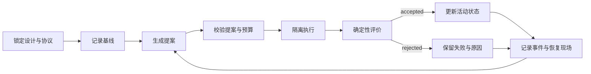

# 运行合同

本文件用于实际执行、预算记账、状态恢复、代码补丁边界和发布审计。技能通过宿主执行器取得真实结果；本文件规定执行器必须提供的最小契约。示例文件位于 `assets/campaign.example.json`、`assets/run_result.example.json`、`assets/baseline_result.example.json` 与 `assets/audit_report.example.json`。



## 1. 运行清单

运行清单是研究开始前的冻结配置。顶层字段固定为：

```text
schema_version：research-campaign/v1
campaign_id：安全的单级路径名称
question：研究问题
research_level：candidate_search / harness_evolution
evidence_level：E1 / E2 / E3 / E4
design_lock：设计锁定卡身份
protocol：协议身份
data_snapshot：数据快照
mapping_version：映射版本
seed：0 到 4294967295 的整数
evidence：证据记录数组
baseline_parameters：基线参数
search_space：允许搜索的参数空间
proposer：提案器声明，可选
runner：执行命令与边界
evaluation：主要指标、门槛与守卫指标
budget：迭代与资源预算
```

未知字段直接拒绝。运行清单与已有状态不一致时，拒绝继续执行，避免同一 `campaign_id` 混入不同设计。配置变化通过新 `campaign_id` 或新运行承接。

### 证据记录

证据数组至少包含一项。每项证据包含：

```text
id：唯一标识
title：标题
source：本地路径或 HTTPS URL，以及 locator
claim：该来源支持的主张
accessed_at：读取日期
```

`source.path` 相对于运行清单所在目录，解析后必须位于该目录内；`source.url` 使用绝对 HTTPS。本地 JSON 来源使用 JSON Pointer 定位，定位必须能够解析到实际值。证据编号在提案中引用；未知编号使提案无效。

### 协议与设计锁定

`protocol` 包含 `id`、`data_role`、`statistical_unit`、`comparison` 和 `frozen`。数据角色为 `development`、`selection`、`confirmation` 或 `independent_oos`。确认与独立样本外阶段要求 `frozen` 为真。

`design_lock` 包含 `status`、`locked_at`、`retrospective` 和 `reference`。`status` 固定为 `locked`；`retrospective` 为布尔值，结果产生后补充的锁定卡必须显式标记。设计锁定卡的完整字段见 [设计与有效性](design-validity.md)。

## 2. 参数空间与提案

`search_space` 中每个参数声明 `type`、可选 `minimum`、`maximum` 与 `choices`。类型为 `number`、`integer`、`boolean` 或 `string`。`baseline_parameters` 与 `search_space` 的键完全一致，且每个值通过声明范围校验。

结构化提案包含假设、理由、否证条件、证据编号、完整参数集合和可选代码补丁。提案必须通过以下检查后才进入执行：

- 字段集合准确，文本非空；
- 证据编号全部存在；
- 参数键与搜索空间一致，值在允许范围内；
- 代码补丁通过边界校验；
- 剩余预算足够。

提案解析失败保留失败记录和已经发生的模型用量，不生成候选结果。自由文本想法不进入执行。

## 3. 确定性评价

评价只读取运行结果、基线与冻结评价配置。采纳条件同时满足：

1. 运行状态为 `succeeded`；
2. 所有必需指标存在且为有限数值；
3. 每个指标的 `limit` 得到满足；
4. 主要指标改善为正，且达到 `minimum_improvement`；
5. 每个守卫指标的退化不超过 `regression_tolerance`。

主要指标改善方向：

```text
minimize：improvement = baseline - candidate
maximize：improvement = candidate - baseline
```

守卫指标退化方向：

```text
minimize：regression = candidate - baseline
maximize：regression = baseline - candidate
```

失败、超时、中断、空结果、无效提案和不可评价项保持原状态，禁止记为零。主要指标改善不能抵消预定行为约束。评价结果保存 `accepted`、`reasons`、`primary_before`、`primary_after` 和 `improvement`。

## 4. 运行结果

每次实际执行保存运行清单：

```text
run_id
iteration
kind：baseline / candidate
proposal
parameters
status：succeeded / failed / interrupted / inconclusive
command
return_code
started_at 与 ended_at
duration_seconds
stdout_path、stderr_path、metrics_path
metrics
errors
environment
```

`environment` 至少记录 Python 版本、平台、Git 提交和 Git 工作区是否存在未提交改动。指标来源为 `stdout_key_value` 时，逐行解析 `name=value`；为 `json_file` 时，读取指定 JSON 文件。重复指标、非数值、非有限值和缺失必需指标都使运行失败。

## 5. 状态、事件与恢复

活动状态保存：

```text
status：ready / running / completed / failed
next_iteration
current_run
accepted_run_id
accepted_parameters
accepted_metrics
consecutive_failures
accepted_patches
code_base_commit
runs
stop_reason
```

事件账本按追加方式记录初始化、运行开始、运行结束、评价、中断、恢复和停止。状态写入使用临时文件替换并同步到磁盘；同一 `campaign_id` 只允许一个写入者持有排他锁。

恢复规则：

- 中断发生在结果记录之前时，该运行标记为 `interrupted`，记录原因，连续失败计数增加，不推断结果。
- 已保存完整提案与用量的运行直接恢复执行，避免重复模型调用。
- 恢复保持协议、输入、评价器、累计预算和代码基准提交一致。
- 需要改变协议、输入身份或评价器时建立新运行，并链接来源运行。
- 已有状态与运行清单不一致时拒绝继续。

## 6. 预算记账

预算覆盖迭代次数、连续失败次数、模型调用、输入输出令牌、墙钟时间和计算资源。调用前检查剩余额度，调用后保存真实用量。解析失败或请求失败也保留已经发生的成本。

恢复继承累计用量。候选开始执行前的失败是否消耗候选位置由协议明确。达到连续失败上限、迭代上限或预算上限时停止，保留已经完成的结果和恢复入口。

## 7. 宿主执行器隔离

- 子进程环境只包含基础变量、显式允许的变量、随机种子变量、参数路径、运行目录和指标路径。
- 环境变量允许清单拒绝名称中包含 `KEY`、`TOKEN`、`SECRET`、`PASSWORD` 或 `CREDENTIAL` 的变量。
- 工作目录解析后必须位于项目根目录内。
- 超时后终止整个进程组，避免子进程继续写入。
- 指标解析拒绝重复键、非数值和非有限值。
- 原始数据、运行输出、日志和恢复现场分目录保存。

## 8. 代码补丁边界

代码补丁只用于协议允许的模型表面。补丁校验至少包含：

- 只接受统一 diff，必须包含 `diff --git` 头；
- 只修改声明的允许路径前缀；
- 拒绝删除、重命名、复制、符号链接、文件模式变化、二进制补丁和子模块；
- 限制补丁字节数与文件数量；
- 拒绝路径逃逸和同一路径重复出现；
- 在独立 Git 工作树中从固定基准提交开始执行；
- 按采纳顺序重放已采纳补丁；
- 运行结束后检查工作区变化，任何未声明修改使运行失败；
- 只有评价通过的补丁进入已采纳集合。

补丁被拒绝时保留补丁文本、违规原因和运行记录。

## 9. 审计报告与发布门槛

审计报告保存为 JSON，顶层字段固定：

```text
schema_version：research-audit/v1
report_id
auditor
scope
commit：被审计提交的十六进制标识
created_at：带时区的 ISO 时间戳
commands：命令与返回码
findings：问题数组
verdict：pass / fail / needs-human
residual_risks
```

每项问题包含 `id`、`severity`、`file`、`line`、`summary`、`failure_scenario`、`evidence`、`status` 和 `recommendation`。严重度为 `critical`、`high`、`medium` 或 `low`；状态为 `open`、`resolved` 或 `accepted-risk`。

判定规则：

- 存在未关闭的 `critical` 或 `high` 问题时，`pass` 无效。
- `pass` 要求所有命令返回零。
- `needs-human` 和 `fail` 阻止发布。
- 报告只评价声明的提交与范围，未运行的检查不能写成通过。

审计检查至少覆盖：

- 代码正确性：状态转移、边界条件、异常路径和恢复语义；
- 会计与守恒：相关主体的恒等式、存量与流量、跨主体收付和时序；
- 数据边界：时点信息集、修订版本、缺失处理、许可和不可再分发数据；
- 可复现性：固定环境、相对路径、完整命令、随机种子和清洁目录运行；
- 安全边界：凭证、子进程环境、路径逃逸、命令注入和不可信代码执行；
- 代码补丁：允许路径、删除与重命名、符号链接、文件模式、补丁大小、工作树基准提交和越界修改；
- 结论一致性：正文数字、图表、运行输出和证据等级一致；
- 负面结果：失败、退化、检验力不足和未获支持的结果没有被删除或改写。

审计过程保持只读。发布门槛顺序：

1. 工作区干净；
2. 项目验证命令通过；
3. 选择与当前提交相同或为其祖先的审计报告；
4. 报告提交之后只允许追加 `research/audits/` 下的报告文件；
5. 报告文件内容与首次提交时一致；
6. 审计检查器通过。

报告提交之后出现其他代码改动时，该报告失效。修复后的提交需要新报告。

## 10. 检查命令

```bash
python3 scripts/check_campaign.py assets/campaign.example.json
python3 scripts/check_campaign.py assets/campaign.example.json \
  --result assets/run_result.example.json \
  --baseline assets/baseline_result.example.json
python3 scripts/check_audit_report.py assets/audit_report.example.json --commit 4f3c2a1
```

清单检查通过只说明结构、证据引用、参数范围和评价字段有效。运行结果通过评价只说明冻结规则得到满足。领域计算、统计推断和研究结论仍需实际审阅。
