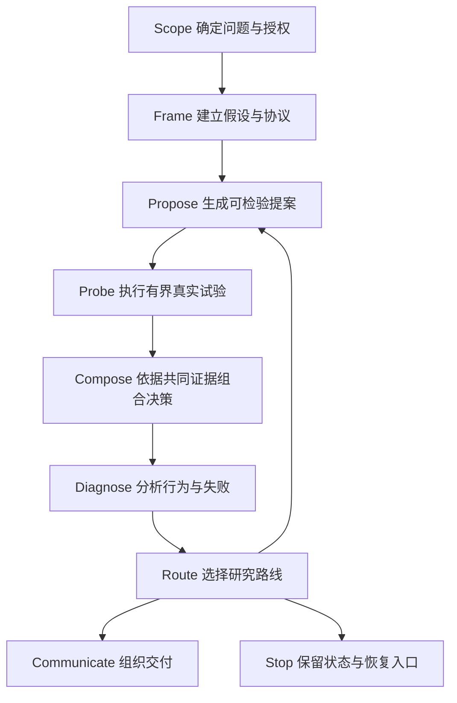

# Research Skill 设计

本文规定 `research` 技能的设计契约。修改触发方式、研究流程、证据结构、执行接口、参考文件或评测时阅读本文。运行研究任务时以 `SKILL.md` 为入口，按需加载 references；本文承担设计解释与变更约束，默认不进入运行上下文。

## 目录

1. 设计依据
2. 技能定位
3. 核心变量与不变量
4. 调用方式与授权边界
5. 研究对象模型
6. 研究闭环
7. Propose–Probe–Compose
8. 路线选择
9. 证据架构
10. 执行器、预算与恢复
11. 记忆与谱系
12. 上下文工程
13. 探索、确认与生产治理
14. 研究表达
15. 技能评测
16. 技能进化
17. 仓库职责与宿主接口
18. 设计验收
19. 公开来源

## 1. 设计依据

本设计采用公开 Agent Skills 方法中的以下约束：

- Anthropic `skill-creator`：从用户意图、触发场景和预期输出开始；使用 `name` 与 `description` 触发；通过 `SKILL.md`、scripts、references 和 assets 组织能力；采用三层渐进披露；使用真实提示、基线、定量检查与人工反馈持续迭代。
- Matt Pocock `writing-for-agents`：把技能视为上下文程序；区分 context load 与 cognitive load；使用 context pointer、leading word、co-location 和单一事实源；为每个步骤设置可观察且具有穷尽性的完成条件。
- Matt Pocock `SKILL-MECHANICS` 与 invocation 规则：区分 model-invoked 与 user-invoked；模型可自动调用可复用纪律，高成本及需要用户承担判断的动作保留给用户触发。
- 诊断驱动研究方法：研究提案读取真实执行轨迹；评价在共同支持上完成；失败与空结果进入后续决策；研究记忆必须影响后续提案；路线变化通过新运行承接。

公开规范约束技能的形态与验证方式，研究方法决定技能在真实研究中的状态、证据和反馈语义。两者共同构成以下设计。

## 2. 技能定位

`research` 是一项 model-invoked 的研究纪律与编排技能。它把用户问题转化为有界研究状态，组织来源读取、可证伪假设、真实执行、诊断、路线选择和研究表达。

技能承担：

- 识别需要研究纪律的任务与相邻近似的非研究任务；
- 确定授权、数据、预算和交付边界；
- 选择当前分支需要加载的最小上下文；
- 将研究问题转化为可执行假设与对照；
- 通过宿主执行器取得真实证据；
- 维护主张状态、失败状态、研究谱系和恢复入口；
- 按证据强度生成文本、图表、代码或研究记录；
- 通过完成条件和行为评测防止提前交付。

技能不直接替代领域执行器、统计库、生产准入系统或作者判断。领域计算由宿主项目提供，技能通过明确接口调用。

适用触发包括可证伪研究、实验设计、证据审查、共同样本比较、失败诊断、负向结果解释、基于真实结果的研究写作和图表交付。简单事实问答、普通文字润色、无证据要求的代码修改保持常规处理。

## 3. 核心变量与不变量

每次技能调用都由八个变量定义：

- **Trigger**：哪类用户意图需要研究纪律。
- **Authority**：模型可以直接执行哪些动作，哪些动作需要用户授权。
- **Procedure**：当前分支按什么顺序改变研究状态。
- **State**：当前问题、协议、活动方案、参照方案、证据和预算是什么。
- **Evidence**：每项主张能够回到哪个来源与定位。
- **Completion**：哪些可观察事实允许当前步骤结束。
- **Reference**：哪些规则只在当前分支加载。
- **Evaluation**：如何验证技能行为、执行结果和研究结论。

以下不变量贯穿所有分支：

1. 每项关键主张具有来源、定位和证据角色。
2. 每次比较具有明确实验单位、共同支持、预算、评价口径和差值方向。
3. 失败、空结果、无效提案和不可评价项保留原状态。
4. 选择过程与最终评价使用分离的信息通道。
5. 模型提案经过结构校验与有界执行后才进入研究状态。
6. 评价器或主要问题变化通过新协议与新运行承接。
7. 研究记忆包含来源与适用范围，并在后续提案中实际使用。
8. 软件检查结果、研究证据状态和作者审阅状态分别报告。
9. 新结果写入新运行或新版本，历史证据保持原貌。
10. 每步完成条件能够由文件、命令输出、状态字段或实际审阅记录核验。

## 4. 调用方式与授权边界

### 4.1 Model-invoked 纪律

`description` 是常驻 context pointer，负责说明能力与触发分支。触发描述使用真实用户语言，覆盖正式表达、自然表达和相邻任务之间的边界。

模型可以自动调用研究纪律的场景包括：

- 已有结果需要解释或核对；
- 用户要求设计或诊断实验；
- 多个条件需要公平比较；
- 研究文本需要绑定实际来源；
- 另一个技能需要研究证据契约。

### 4.2 用户保留的决定

以下动作在执行前取得明确授权：

- 读取新的敏感数据、封闭窗口或外部私有来源；
- 启动高成本计算、长期训练或大规模搜索；
- 修改生产配置、正式库、活动指针或公开结论；
- 发布、提交、删除、覆盖历史证据或执行其他高影响操作；
- 改变研究问题所依赖的价值判断、验收责任或公开展示范围。

环境能够回答的事实由模型查询，涉及后果与责任的决定由用户作出。技能不得自行生成用户答案来闭合授权缺口。

### 4.3 技能之间的调用

用户触发的研究编排可以调用 model-invoked 的证据审查、图表、写作或诊断技能。高成本及高影响的用户触发流程由用户直接启动。跨技能复用时使用宿主提供的显式技能调用机制，保持调用方向与授权方向一致。

## 5. 研究对象模型

### 5.1 两个研究层次

**Candidate search** 处理具体候选，例如表达式、程序、模型、实验配置或机制组合。其输出是候选及真实评价。

**Research-harness evolution** 处理产生候选的执行系统，例如提案策略、上下文、记忆、诊断、实验分配、搜索算子、预算和停止设计。其输出是可检验的 harness 假设、执行证据和谱系。

每次运行声明当前层次。候选数量或文本差异不能代替 harness 行为证据，harness 改动也不能由单个候选表现直接推断普遍优势。

### 5.2 核心对象

- `ResearchQuestion`：对象、干预、比较、主要指标、适用范围、支持与否证条件。
- `ResearchState`：当前问题、活动方案、参照方案、协议版本、预算、分支和证据状态。
- `Protocol`：数据角色、共同支持规则、执行预算、种子、评价器、主要指标、约束和停止条件。
- `Proposal`：可检验假设、最小编辑、预期机制、适用范围和否证条件。
- `Probe`：在共同开发与选择口径下执行的有界试验。
- `EvidencePacket`：结果、诊断、成本、失败、来源定位和允许向模型披露的信息。
- `Claim`：主张文本、状态、证据角色、定量字段和来源。
- `RouteDecision`：路线、依据、影响对象、预算和后续承接运行。
- `Run`：一次不可混淆的执行现场及其恢复入口。

执行中状态的完整检查要求问题、协议、提案、路线、记忆使用声明和恢复现场同时存在。Frame 阶段可以只保存问题与协议；首次 Probe 前不强制使用完整执行状态检查。

### 5.3 活动方案与参照方案

活动方案承接已执行的局部改动，可以暂时处于负增量或未采纳状态。参照方案是当前被承认的比较基线，只有在共同支持上满足采纳契约后才更新。

该区分保留跨步恢复能力：局部修复可以从中间状态继续，最终比较仍然面对同一参照方案。任何分支都不能用独立运行中较有利的样本绕过共同终评。

## 6. 研究闭环

### Scope

读取用户目标、当前项目事实和已有材料。明确允许来源、排除来源、数据角色、可写位置、外部操作和预算。

完成条件：研究问题、交付物、授权边界和成功标准可定位；只读任务保持只读。

### Frame

把现实困难或证据矛盾转化为一个主要问题。声明干预、比较对象、主要指标、实验单位、支持结果、否证结果和无法判定条件。

完成条件：协议能够由另一位执行者运行，主要分析与诊断具有不同职责。

### Propose

生成少量具有机制差异的提案。每项提案同时携带假设、最小执行编辑、预期行为和失败解释，避免只给候选名称或自由文本想法。

完成条件：提案通过结构校验，能够在既有执行表面上实施，且不包含未授权输入。

### Probe

在真实小规模执行中比较提案与参照。各臂共享数据、预算、种子、评价实现和共同支持，记录结果、成本与失败。

完成条件：每个候选具有明确执行状态和可追溯结果；预算与实际用量已经记账。

### Compose

根据主要指标、行为约束、机制差异和成本作出 `kept`、`revised`、`dropped` 或 `inconclusive` 决策。组合多个编辑时重新执行组合候选，避免由单项结果直接推断组合效果。

完成条件：每项决定具有数字证据或明确无法判定原因，活动方案与参照方案按契约更新。

### Diagnose

分析执行轨迹、失败类别、覆盖率、行为代价、机制差异和资源消耗。诊断用于解释主要结果与选择下一问题。

完成条件：基础设施故障、实现错误、协议违例和假设未获支持具有可区分的证据状态。

### Route

在继续利用、修复、分叉、重构问题和停止之间作出有界选择。路线决定读取精简证据，不接触最终评价或受限原始数据。

完成条件：路线及其依据进入 route history，后续运行身份和预算明确。

### Communicate

按证据角色组织文本、图表和记录。交付实际候选、检查命令、结果、限制和恢复入口。

完成条件：内容检查、软件检查和作者审阅按真实执行状态登记。

## 7. Propose–Probe–Compose

### 7.1 Propose 的信息契约

提案输入只包含当前决策所需的信息：

- 当前研究问题与协议身份；
- 活动方案和允许编辑的表面；
- 参照方案的匹配结果；
- 已脱敏的逐候选诊断与失败类别；
- 与当前问题相关的历史经验；
- 剩余预算与输出 schema。

每项提案说明预期影响哪个行为，以及哪个观察会否定该预期；提案记录假设、最小编辑、预期机制、适用范围、否证条件、模型身份和真实用量。该要求让后续诊断能够评价机制解释，同时保留自由探索空间。

### 7.2 Probe 的对照契约

Probe 使用匹配条件：

- 同一数据版本和数据角色；
- 同一任务、种子与输入；
- 同一候选、调用、令牌、时间或计算预算；
- 同一评价代码与共同支持；
- 同一失败和缺失处理规则。

Probe 服务于候选选择与机制诊断。选择阶段可见的信息与最终确认信息分离，模型输入由白名单控制。

### 7.3 Compose 的采纳契约

Compose 不依赖单一聚合分数。主要指标回答研究问题，约束指标保护覆盖、稳定性、成本、多样性或其他关键行为，诊断指标解释变化来源。

候选在共同支持为空、身份不一致、预算不同或评价口径冲突时进入 `inconclusive`。新指标或新约束出现在结果之后时，登记为后续研究问题。

组合决策保存每个编辑的来源、单独结果、组合结果和舍弃原因。被舍弃候选继续存在于谱系中。

## 8. 路线选择

路线是研究控制层的一部分，具有明确权限与状态转移：

- `EXPLOIT`：在当前问题和协议内利用已有机制，执行局部提案。
- `REPAIR`：针对已定位的执行或实现缺陷进行修复，使用相同评价口径复核。
- `FORK`：保留当前状态，围绕不同机制路径建立新分支。
- `REFRAME`：根据证据矛盾重设研究问题，建立新协议和新运行。
- `STOP`：预算耗尽、问题已回答、证据持续无法判定或继续执行缺乏信息价值时停止当前路线。

`FORK` 与 `REFRAME` 只生成下一状态及承接身份，不在当前运行中改写参照方案或评价器。`STOP` 只记录停止与原因，不生成虚构的研究步骤。

路线历史保留成功、失败、无效提案、部分执行和恢复决定。经验库保存可迁移经验，路线历史保存实际控制过程，两者具有不同查询用途。

## 9. 证据架构

### 9.1 Evidence seam

Evidence seam 是能够独立核对主张的最小位置。它可以是一个结果字段、一条执行记录、一段原文、一个图表输入或一组共同支持定义。

每个主张绑定对象、表述、状态、证据角色和来源定位。定量主张额外保留指标、数值、单位、分母、比较方向、总体或窗口和统计单位。

证据角色包括：

- `primary`：直接回答主要问题；
- `diagnostic`：解释机制、失败或行为代价；
- `contextual`：提供背景与检索线索。

主张状态包括 `supported`、`contradicted`、`inconclusive` 和 `unverified`。状态转换由实际来源驱动，措辞变化不能扩大证据范围。

### 9.2 数据角色与信息隔离

开发数据用于形成假设，选择数据用于候选比较，确认数据用于冻结后的评价。内部留出保持其开发证据身份，独立样本外证据需要满足宿主项目的独立性与时间顺序要求。

模型输入只包含当前阶段允许的派生证据。原始敏感数据、封闭窗口、最终确认结果和其他受限字段在进入模型前由结构化白名单剔除。

### 9.3 共同支持

跨候选比较先确定共同可评估实验单位，再在共同支持上计算指标与差值。候选覆盖差异、运行缺失或输入变化不得转化为有利样本选择。

共同支持不足时报告无法判定，并说明排除规则和剩余选择偏差。所有参与主要比较的条件使用同一支持定义。

### 9.4 失败与缺失

`null`、超时、无效提案、部分执行和协议违例保持不同状态。失败结果不自动等于零，基础设施重试不自动增加研究样本，模型重试的预算处理由协议决定。

负面结果、行为代价与主要结果同时交付，避免只保留有利方向。

## 10. 执行器、预算与恢复

### 10.1 职责分配

模型负责假设形成、语义分析、提案生成、诊断解释和表达。确定性程序负责结构校验、数据过滤、预算检查、执行、评价、记录与恢复。重复出现的确定性操作沉淀为 scripts，并通过真实用例验证。

宿主执行器提供领域计算，技能定义其输入输出契约。技能不通过自由文本猜测执行结果。

### 10.2 执行接口

宿主研究执行器按以下接口接入：

- `prepare`：校验问题、协议、输入身份和预算，创建新运行现场。
- `propose`：接收白名单上下文，返回结构化提案及真实模型用量。
- `execute`：在授权数据与预算内执行提案，保存中间状态。
- `evaluate`：在共同支持上计算主要指标、约束和诊断。
- `compose`：依据采纳契约更新活动状态并记录决定。
- `resume`：从已持久化现场继续，保持协议、输入和代码身份。

接口实现可以同步或异步，状态语义保持一致。

### 10.3 预算

预算覆盖候选位置、模型调用、输入输出令牌、执行时间、计算资源和连续无改进次数。调用前检查剩余额度，调用后保存真实用量，解析失败也保留已经发生的成本。

恢复时继承累计用量。已经保存完整提案与用量的情况下直接恢复执行，避免重复模型调用。候选开始执行前发生的失败是否消耗候选位置由协议明确。

### 10.4 恢复与历史

每个实际运行保存配置、结果、必要 trace 和恢复命令。确认性运行额外保存冻结协议、共同支持定义和各条件结果。

恢复保持输入身份、预算与评价器一致。需要改变这些身份时建立新运行，并链接其来源运行。

## 11. 记忆与谱系

研究记忆分为三类：

- **Run memory**：当前运行内的配置、提案、结果、失败和成本。
- **Experience memory**：跨运行可迁移的条件化经验。
- **Route history**：路线决定、分支、停止和恢复过程。

经验条目包含 `cue`、`lesson`、`evidence`、`confidence` 和 `applicability`。提案器按当前问题选择相关经验，并在输出中记录实际使用的条目标识。

只写入日志且从未影响后续提案的内容不构成研究记忆。经验从其他领域迁移时保持其适用范围，新的执行证据可以加强、削弱或撤回该经验。

谱系保存编辑来源、父运行、共同支持、采纳状态和后续效果。分支用于检验不同机制路径，单纯增加种子或代理数量仍属于同一机制路径的重复。

## 12. 上下文工程

### 12.1 三层加载

1. `name` 与 `description` 常驻，承担触发。
2. `SKILL.md` 在技能触发后加载，保留每个分支共享的步骤、硬边界和完成条件。
3. references、scripts 和 assets 按分支加载或执行，承载详细契约、确定性工具和模板。

`SKILL.md` 以公开指南建议的 500 行以内为设计约束。超过 300 行的参考文件提供目录。引用指针说明材料内容和读取分支，避免把触发条件藏在句尾。

### 12.2 Context pointer

每个 pointer 前置当前分支的 leading word，并清楚说明何时读取。相同分支只保留一个指针，正文已经表达的身份信息不重复写入 pointer。

优先加强 pointer 的措辞，再判断是否需要内联。内联增加常驻注意力成本，适用于所有分支都依赖的规则。

### 12.3 Co-location 与单一事实源

同一概念的定义、规则和例外放在同一标题下。每个含义只设一个权威位置，其他文件通过 pointer 使用。

环境已经能够可靠提供的命令参数、版本、路径和当前状态由环境保存。文档保存无法从代码直接得知的设计理由、边界、失败语义和完成条件。

### 12.4 Leading words

本设计使用稳定词汇：

- `seam`：可以观察行为或独立核对证据的最小边界。
- `frontier`：前置条件已经满足、当前能够决策的问题集合。
- `frozen`：在结果读取前锁定，后续变更通过新版本承接。
- `probe`：用于选择与诊断的有界执行。
- `compose`：依据执行证据形成采纳、修订或舍弃决定。
- `common support`：所有比较条件共同可评估的实验支持。
- `route`：研究控制层的下一步方向。
- `evidence role`：证据在主要结论、诊断或背景中的职责。

同一概念在 description、正文、脚本字段和评测中保持同名。新词需要证明能够压缩一组稳定行为。

### 12.5 修剪

定期检查每句话是否改变模型行为。删除没有行为作用的整句，合并重复含义，将分支专属材料移到按需参考。

上下文精简通过真实运行验证。过晚加载关键规则与过早加载全部规则都属于需要诊断的设计问题。

## 13. 探索、确认与生产治理

### 探索性研究

预算由研究问题决定，优先运行能够区分竞争解释的小实验。默认保存配置、结果、必要 trace 和恢复命令。失败与空结果参与下一步诊断，轻量记录足以支持理解与重跑。

### 确认性对照

在读取结果前固定模型、协议、数据角色、预算、种子、主要指标、统计单位、差值方向、缺失处理、停止条件和多重比较策略。冻结后重新运行受影响的基线与候选，保持历史版本可核对。

### 生产与正式准入

生产停止规则、正式库准入和公开强结论由宿主项目的专门流程管理。探索技能提供证据与诊断，不自动取得生产写入权限。

软件 guard 通过只说明相应软件检查完成。研究有效性继续依赖问题、对照、执行证据和结论边界。

## 14. 研究表达

研究文本按照问题和证据组织。方法描述组件输入、输出、信息传递与选择理由；结果段回答具体比较；讨论段解释机制、代价和适用范围。

图表先声明需要回答的问题，再确定输入字段、过滤、聚合、实验单位和图注。实际导出尺寸下检查标签、刻度、图例和重叠，数据图保留可编辑或矢量来源。

修改已有文本时分别检查：

- 语义保留：对象、数字、方向、条件和结论强度保持准确；
- 阅读作用：目标读者能够更容易理解研究关系；
- 机械检查：受保护字段、链接、格式和生成物通过相应检查；
- 作者审阅：只登记实际发生的审阅。

接受、拒绝和待修订样本都可成为后续技能诊断材料。改动率与句子长度不作为研究表达质量分数。

## 15. 技能评测

### 15.1 评测层次

- **结构验证**：frontmatter、引用路径、配置 schema 和安装载荷有效。
- **工具测试**：scripts 的输入、错误、边界和恢复行为具有回归覆盖。
- **行为评测**：技能在真实提示下遵守证据、对照、诊断与交付契约。
- **触发评测**：应当触发与相邻近似的不得触发查询覆盖真实表达。
- **版本比较**：候选技能与基线在相同引擎、模型、环境、输入和 judge 下比较。
- **研究有效性审查**：实际研究问题与执行证据支持相应结论。

### 15.2 最小行为矩阵

行为套件覆盖：

1. 开发证据与独立样本外证据的边界；
2. 覆盖范围不同的条件之间的共同支持比较；
3. 部分失败、空结果和基础设施故障的诊断；
4. 结果出现后改变主要指标的诱惑场景；
5. 缺少来源、来源冲突和无法判定主张；
6. 最终评价信息泄漏到提案输入的防护；
7. 预算耗尽、模型失败和已持久化提案的恢复；
8. `FORK`、`REFRAME` 与 `STOP` 的状态承接；
9. 只写日志且未被后续使用的伪记忆；
10. 文本、图表和数字来自不同证据版本的交付冲突。

每个用例指定输入、预期行为、可观察断言和需要人工判断的部分。关键分支同时包含正向与相邻反例。

### 15.3 基线与判定

新技能与无技能基线比较，技能修改与冻结旧版本比较。各版本使用相同提示、工具权限和评判口径，保留独立输出目录。

确定性断言检查可观察契约，语义质量由实际输出审阅或独立 judge 评价。断言过宽、断言只复述提示、执行超时和模型基础设施失败分别登记，避免混入技能缺陷。

对不稳定用例在预算内进行重复测量，报告波动、时间、令牌和执行成本。单次通过或总分提高不足以证明稳定改进。

### 15.4 触发评测

触发集包含正式表达、自然表达、拼写变化和真实上下文。不得触发集合重点覆盖共享关键词却需要其他技能的近似任务。

描述优化在独立查询上检查，避免根据少量训练提示过拟合触发词。

## 16. 技能进化

技能改进从实际 transcript、输出、失败断言、工具调用和用户反馈开始。先区分技能缺陷、评测缺陷、执行基础设施问题和研究结论不确定，再修改对应层。

每次修改保持原版本及其运行证据，候选版本使用相同评测条件比较。修改目标写成可观察行为，避免只追求文本风格或单次分数。

重复出现的确定性工作沉淀为脚本。重复出现的判断经验形成候选规则，记录：

- 适用条件；
- 编辑或执行动作；
- 来源与实际案例；
- 反例与不适用情况；
- 验收问题；
- 需要替换的旧规则。

写作规则等可迁移经验在独立研究或章节分组上验证。采用前至少取得三个真实应用案例，覆盖两个与提炼材料分离的分组，并分别记录语义保留与阅读作用。合成用例按实际证据角色登记。

候选内容变化后重新验证。规则替换保留旧版本与恢复事件，恢复本身也形成可追溯记录。

## 17. 仓库职责与宿主接口

- `SKILL.md`：模型触发后的共享步骤、分支 pointer 和完成条件。
- `skill_design.md`：技能设计、状态语义、接口契约和变更验收依据；修改技能时读取。
- `references/evidence.md`：主张、来源、证据角色和缺失处理。
- `references/experiments.md`：假设、共同支持、预算、统计与失败诊断。
- `references/research-loop.md`：两个研究层次、Propose–Probe–Compose、路线和记忆。
- `references/execution.md`：宿主执行接口、信息隔离、预算、恢复与治理。
- `references/communication.md`：论证、图表、文本和交付检查。
- `assets/`：主张记录、执行中研究状态与可复用示例。
- `scripts/`：研究记录检查器、研究状态检查器和重复操作。
- `evals/`：技能安装、真实行为与回归评测。
- `agents/openai.yaml`：宿主界面与调用元数据，保持和 `SKILL.md` 的调用方式一致。

Propose–Probe–Compose、路线控制、经验记忆和预算恢复构成宿主研究执行器的接口契约。当前仓库提供技能层规范与通用检查工具，领域执行器由使用技能的项目实现并接入。

新增能力优先组合现有技能与宿主工具。只有出现独立触发词、独立完成条件和无法由现有组合覆盖的职责时，才拆分新技能。

## 18. 设计验收

### 触发与权限

- [ ] `description` 同时说明能力和真实触发分支。
- [ ] model-invoked 与 `agents/openai.yaml` 保持一致。
- [ ] 高成本、高影响和需要用户判断的动作具有明确授权边界。
- [ ] 触发评测包含相邻近似的不得触发任务。

### 上下文与文档

- [ ] `SKILL.md` 只保留共享步骤、硬边界和完成条件。
- [ ] 每个外部 reference 都有带分支条件的 pointer。
- [ ] 同一含义只有一个权威位置。
- [ ] 环境事实由环境保存，文档没有易腐化副本。
- [ ] 长参考提供目录，按需加载路径经过真实运行验证。

### 研究状态与证据

- [ ] 当前研究层次、主要问题和实验单位明确。
- [ ] 活动方案与参照方案的更新规则明确。
- [ ] 每项关键主张能够回到 evidence seam。
- [ ] 共同支持、数据角色、失败状态和差值方向可核对。
- [ ] 选择信息与最终确认信息隔离。
- [ ] 路线、谱系和实际使用的记忆具有来源。

### 执行与恢复

- [ ] 提案通过结构校验后才进入执行。
- [ ] 预算在调用前检查，真实用量在调用后保存。
- [ ] 恢复保持协议身份并继承累计成本。
- [ ] 新协议、新评价器和新研究问题通过新运行承接。
- [ ] 失败、空结果和部分执行保持可见。

### 评测与交付

- [ ] 结构、工具、行为和触发评测具有相应覆盖。
- [ ] 候选版本与匹配合适基线比较。
- [ ] 评测缺陷、基础设施失败和技能缺陷分别诊断。
- [ ] 时间与令牌成本随结果保存。
- [ ] 交付包含实际候选、检查命令、结果、限制和恢复入口。
- [ ] 研究证据状态、软件检查状态和作者审阅状态分别报告。

## 19. 公开来源

以下来源于 2026-11-01 实际读取，链接固定到读取时的提交：

- Anthropic `skill-creator`：技能意图、触发描述、三层渐进披露、资源组织、真实评测、基线比较、反馈迭代与描述优化。
  <https://github.com/anthropics/skills/blob/b0cbd3df1533b396d281a6886d5132f623393a9c/skills/skill-creator/SKILL.md>
- Matt Pocock `writing-for-agents`：context pointer、两类负载、信息层级、完成条件、leading words、修剪和单一事实源。
  <https://github.com/mattpocock/skills/blob/4ae2317ddb22b046e26455e4f9c9b3aaaf62212d/skills/productivity/writing-for-agents/SKILL.md>
- Matt Pocock `SKILL-MECHANICS`：调用方式、调用拆分和 router 边界。
  <https://github.com/mattpocock/skills/blob/4ae2317ddb22b046e26455e4f9c9b3aaaf62212d/skills/productivity/writing-for-agents/SKILL-MECHANICS.md>
- Matt Pocock invocation 规则：model-invoked、user-invoked、跨技能调用和宿主元数据一致性。
  <https://github.com/mattpocock/skills/blob/4ae2317ddb22b046e26455e4f9c9b3aaaf62212d/.agents/invocation.md>
